<p align="center">
  
</p>

<p align="center">
  <a href="https://github.com/letianz3">
    
  </a>
</p>

<p align="center">
  <a href="https://www.linkedin.com/in/letian-zhang3"></a>
  <a href="https://github.com/letianz3?tab=followers"></a>
  <a href="https://github.com/letianz3"></a>
</p>

<br>

<table align="center">
<tr>
<td width="55%" valign="top">

### 🧑‍💻 About me

```python
class Leo:
    school     = "CMU · M.S. AI Engineering"
    previously = "NXP Semiconductors"
    building   = ["agent harnesses",
                  "multi-agent orchestration",
                  "verification & evals"]
    also_into  = ["reinforcement learning",
                  "game modding"]
    motto      = "Let code decide."
```

</td>
<td width="45%" valign="top">

### 🔭 Right now

- 🤖 Making agents **verify** before they answer
- 🧪 Running **trace-driven** evals, one failure at a time
- 🧩 Tinkering with **reverse engineering** on the side
- 🌱 Open to **AI agent** roles and collaborations

</td>
</tr>
</table>

## 🛠️ Featured projects

<p align="center">
  <a href="https://github.com/letianz3/gaia-agent-harness"></a>
  <a href="https://github.com/letianz3/secure-document-agent"></a>
  <a href="https://github.com/letianz3/sanguosha-ios-general-port"></a>
</p>

## 🧰 Tech stack

<p align="center">
  <br>
  
</p>

## 📈 GitHub activity

<p align="center">
  
</p>

<p align="center">
  
</p>
